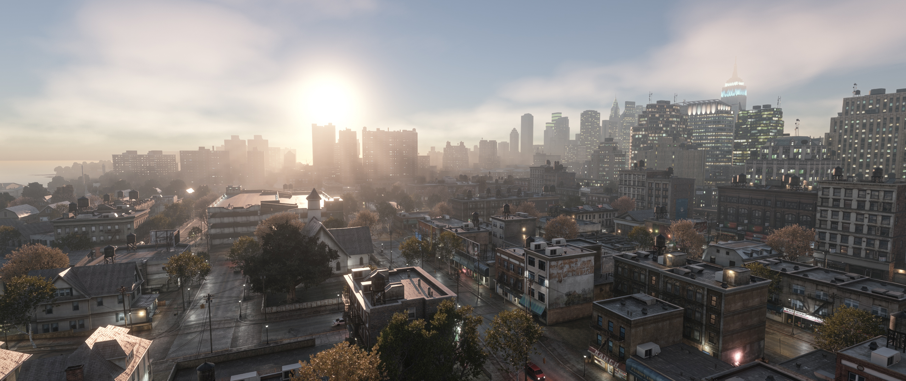
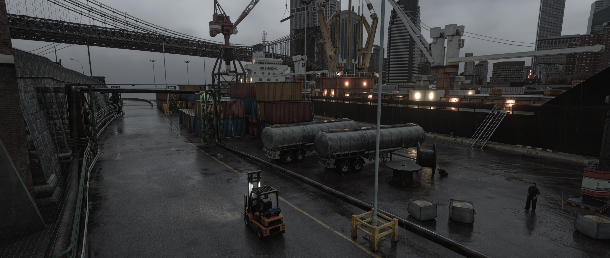
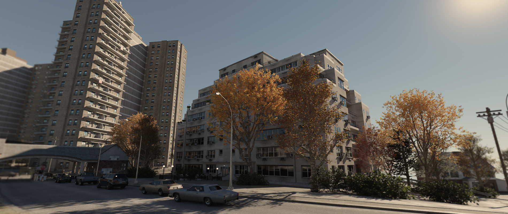
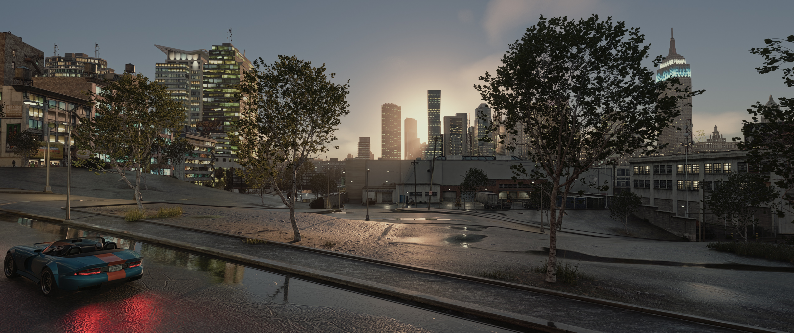
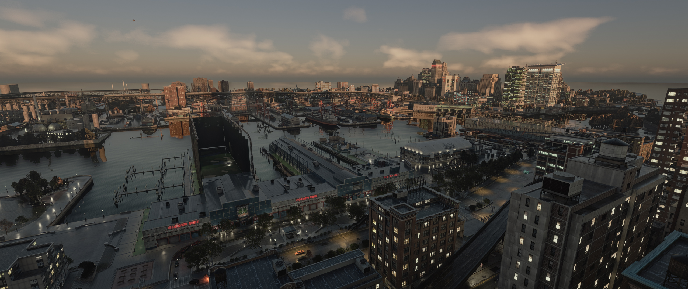
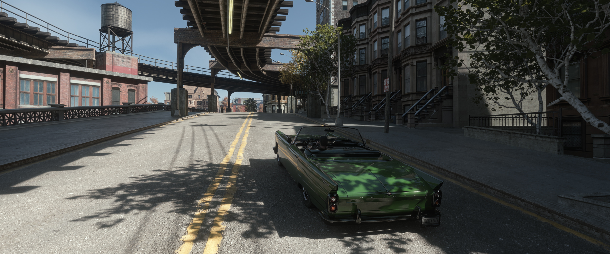
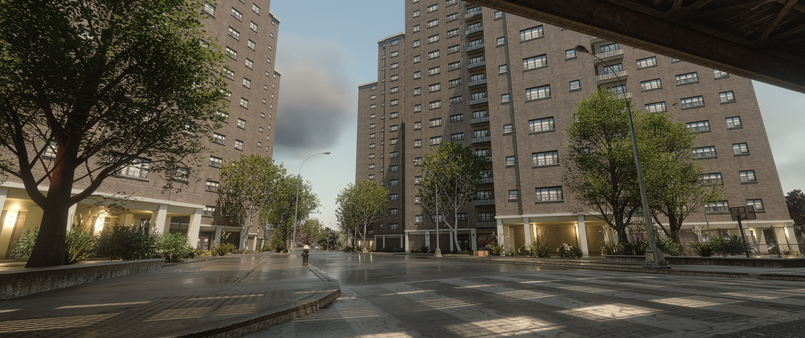

<h1 align="center">Grand Theft Auto IV - RTX Remix Compatibility Mod</h1>

 

 

Made specifically for NVIDIA's [RTX Remix](https://github.com/NVIDIAGameWorks/rtx-remix).  
Compatible with __Grand Theft Auto IV: The Complete Edition (1.2.0.59)__ 

If you want to support my work,   
consider buying me a [Coffee](https://ko-fi.com/xoxor4d) or by becoming a [Patreon](https://patreon.com/xoxor4d)

Feel free to join the discord server: https://discord.gg/FMnfhpfZy9

 

 

### Table of Contents

__[Overview](#overview)__  
__[Installing](#installing)__   
__[Uninstalling](#uninstalling)__   
__[Usage](#usage)__   
__[Compiling](#compiling)__   

 

## Overview

 

First and foremost, __this is not a remaster__.  
It is a mod that allows the game to be modded with NVIDIA's [RTX Remix](https://github.com/NVIDIAGameWorks/rtx-remix).  
It comes with a [Baseline Remix Mod](https://github.com/xoxor4d/gta4-rtx-base-mod) and [GTAIV-AutoPBR](https://github.com/xoxor4d/gta4-rtx-autopbr-mod).  

 

RTX Remix has a certain overhead because of how it works and intercepts the game's draw calls and   
there are obvious drawbacks and things that will not work with such a new title. Don't expect this to be perfect.  

You can run into CPU bottlenecks because of the amount of detailed meshes the game is rendering.  
This means that the performance you'll see in certain places is not entirely due to pathtracing.  

 

The mod comes with a custom [Remix Runtime](https://github.com/xoxor4d/dxvk-remix/tree/game/gta4) required for game specific features and optimizations,   
with [Ultimate ASI Loader](https://github.com/ThirteenAG/Ultimate-ASI-Loader/releases/tag/v9.0.0) to load the Compatibility Mod itself and a custom fork of [FusionFix](https://github.com/xoxor4d/GTAIV.EFLC.FusionFix.RTXRemix) tailored for RTX-Remix.

 

 

###### The good:  
- **DLSS 4.5 (Ray Reconstruction 2) support**
- **DLSS 5.0 (V2) (Neural Rendering) support** - Official NV version (with additional changes by [Sparkles (RemixPlus)](https://github.com/RemixProjGroup/dxvk-remix/commits/rebased-9-19/)
- Includes an **Atmospheric sky system with Volumetric Clouds** made by the Community [Remix Plus / Numos](https://github.com/RemixProjGroup/dxvk-remix)
- **99% of Meshes are Rendered via the RemixApi** - this drastically improves performance and reduces the CPU-Bottleneck
- Full fixed-function fallback in case the API isn't used. Still increases performance compared to grabbing data from Vertexshaders
- Cascaded Anti Culling of meshes
- All game lights (including the sun) are translated to remix lights
- Ability to create overrides for translated game lights (change position, color, intensity etc.)
- Vehicles now feature two headlights and two rear lights instead of single, centered ones
- Dynamic emissive surfaces work (vehicle lights, building-windows, shops etc.)
- Dynamic wetness with forming puddles + wetness stays longer after it rained
- Improved water / ocean rendering
- Raindroplets on vehicles and characters
- Working vehicle dirt and livery
- Working distant light sprites and vehicle imposters
- Modification of remix runtime variables based on current timecycle settings
- Mobilephone works (but it is 3D and currently scales with the camera fov)
- Modified vertex shaders (based on FusionFix) so that remix is able to capture surface normals
- Ability to spawn unique _marker_ meshes that can be hidden based on distance, weather or time of day (these can be used to attach remix replacements or scene lights)
- Screenshot Mode, FreeCam Mode and other Utilities
- FusionFix compatible (custom fork: [GTAIV.EFLC.FusionFix.RTXRemix](https://github.com/xoxor4d/GTAIV.EFLC.FusionFix.RTXRemix))
- Many tweakable settings via the in-game __F4__ menu
- A few PBR materials, hq-meshes (vegetation, modeled fences ..) and texture fixes
- Mod Installer / Updater

###### The bad:
- ~~CPU Bottlenecked~~ - Rendering via RemixApi + Improvements to the Bridge by [Sparkles (RemixPlus)](https://github.com/RemixProjGroup/dxvk-remix/commits/rebased-9-19/) and me mostly fixes this
- ~~Can still be stuttery when traversing the world as new meshes load in~~ - Mostly fixed as of 1.7.0
- ~~No blood on peds~~ - Fixed as of 1.7.0

 
 

 

 

## Installing the Mod
- Grab the latest [Release](https://github.com/xoxor4d/gta4-rtx/releases) and follow the instructions found there

## Uninstalling the Mod
- Delete `d3d9.dll` and `a_gta4-rtx.asi` or use the provided `_toggle-gta4-rtx.bat` to quickly toggle RTX-Remix
- Some other minor files remain in the updates folder (mainly `.img` files starting with `1__remix ..`)
- Re-install the official FusionFix mod if you used the custom Fork

 

## Usage
- Run the game like normal
- Press `F4` to open the in-game gui for some compatibility tweaks or debug settings
- If you notice heavy stuttering, launch the game with one of the included affinity batch files.  
  They give GTA IV its own physical cores and the rest to Remix, so the two never compete for the same core:
  - `_LaunchWithProcessorAffinity_4Cores_GTA4.bat`: 4 physical cores for GTA IV (CPUs with 8 or more cores)
  - `_LaunchWithProcessorAffinity_2Cores_GTA4.bat`: 2 physical cores for GTA IV (CPUs with fewer cores)

 

> [!TIP]  
> **Performance Tips / Troubleshooting and Usage information can be found in the [[Wiki]](https://github.com/xoxor4d/gta4-rtx/wiki)**

 

## Compiling
- Clone the repository `git clone --recurse-submodules https://github.com/xoxor4d/gta4-rtx.git`
- Optional: Setup a global path variable named `GTA4_ROOT` that points to your game folder (where GTAIV.exe is located)
- Run `generate-buildfiles_vs22.bat` to generate VS project files
- Compile the mod
- If you did not setup the global path variable:  
  rename `gta4-rtx.dll` to `a_gta4-rtx.asi` and copy it into your game directory (next to `GTAIV.exe`) 
- If you have not installed a release build before, make sure to copy everything within the `assets` folder into the game directory
- Make sure to also install: [gta4-rtx-base-mod](https://github.com/xoxor4d/gta4-rtx-base-mod)

#### Profiling with Tracy
- Build the `ReleaseTracy` configuration - includes [Tracy](https://github.com/wolfpld/tracy) client (v0.13.4, `deps/tracy`)  
  All other configurations contain no profiling code.
- Start the game, open the Tracy 0.13.x profiler and connect
- The trace contains frame marks for the render thread (`Render`) and the game thread tick (`Game`), zones for the D3D9 and Remix API render paths, every Remix API bridge call, the culling and draw list hooks, plots (frame time, draw calls, api instances) and the locks of the api renderer
- Run `GTAIV.exe` as administrator to also get CPU sampling and context switches of all threads

 
 

##  Credits
- [NVIDIA - RTX Remix](https://github.com/NVIDIAGameWorks/rtx-remix)
- [People of the showcase discord](https://discord.gg/j6sh7JD3v9) - especially the nvidia engineers ✌️
- [Dear ImGui](https://github.com/ocornut/imgui)
- [imgui-blur-effect](https://github.com/3r4y/imgui-blur-effect)
- [minhook](https://github.com/TsudaKageyu/minhook)
- [toml11](https://github.com/ToruNiina/toml11)
- [Ultimate-ASI-Loader](https://github.com/ThirteenAG/Ultimate-ASI-Loader)
- [miniz](https://github.com/richgel999/miniz)
- [Rapidjson](https://github.com/Tencent/rapidjson)
- [DiscordRPC](https://github.com/discord/discord-rpc)
- [Tracy](https://github.com/wolfpld/tracy)
- [FusionFix](https://github.com/ThirteenAG/GTAIV.EFLC.FusionFix)
- [FusionShaders](https://github.com/Parallellines0451/GTAIV.EFLC.FusionShaders)
- [Rage-Shader-Editor](https://github.com/ImpossibleEchoes/rage-shader-editor-cpp)
- [IV-SDK](https://github.com/Zolika1351/iv-sdk/)
- [IV-SDK-DotNet](https://github.com/ClonkAndre/IV-SDK-DotNet)
- [AssaultKifle47](https://github.com/akifle47)
- [DayL](https://www.gtainside.de/de/user/falcogray)
- [Entity](https://www.youtube.com/@paprykszadolowski8796)
- [Gabdeg](https://www.youtube.com/@gabdeg793)
- [Hemry](https://www.youtube.com/@Hemry81)
- [Danlopand / Thundery_Dan](https://github.com/DANLOPAND)
- [KapibosRU](https://www.youtube.com/channel/UCqZ2NI_fQKRN-Onypt9aIGQ)
- [Budgie (Vegetation)](https://www.patreon.com/c/BudgieGames)
- [Alex from Digital Foundry](https://www.youtube.com/watch?v=vGxPdcMQfwg)
- [Sparkles (Remix Plus - Numos - Remix Optimization)](https://github.com/Kim2091)
- [CR (Remix Plus)](https://github.com/sambow23)
- [TheGreatHMMMM (Remix Plus)](https://github.com/TheGreatHMMMM)
- [Gokuwashere (Remix Plus)](https://github.com/BrunchyChineapple)
- All 🍓 Testers

 

And of course, all my fellow Ko-Fi and Patreon supporters  
and all the people that helped along the way!

 

